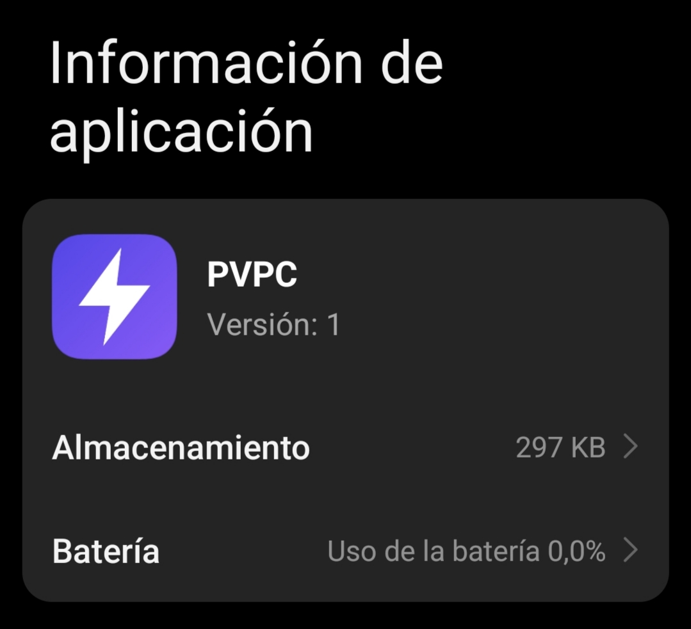

# PVPC España · Frontal

Interfaz web de [pvpc.linaresdigital.com](https://pvpc.linaresdigital.com): precio de la luz
(PVPC) hora a hora, hoy y mañana. La documentación general del proyecto está en
[`nucleo`](https://github.com/pvpc-espana/nucleo).

- **Angular 22** (componentes *standalone*, *signals*, sin zone.js) y **Transloco** para los
  6 idiomas (`src/i18n/*.json`, empaquetados con *hash* para que nunca se mezclen con
  traducciones antiguas en caché).
- Lee los JSON de `https://datos.pvpc.linaresdigital.com/v1/` (`src/app/core/config.ts`).
- Mobile-first: deslizar el dedo, botones arriba y abajo o flechas del teclado para cambiar
  de día; tema automático, claro u oscuro.
- Clasificación de cada hora (color e icono) en `src/app/core/umbrales.ts`.
- Recordatorios: horas marcadas exportables a `.ics` o Google Calendar.
- Aplicación instalable (PWA) con *service worker* de Angular (`ngsw-config.json`): la app
  abre sin conexión, avisa de versiones nuevas y muestra un botón «Instalar» (diálogo del
  navegador en Chrome/Edge; instrucciones en iPhone/iPad).
- Modo sin conexión: los precios de hoy y mañana se guardan en `localStorage` al
  descargarlos. Si una descarga falla se muestran esos precios con el aviso «Sin conexión»
  bajo la cabecera, encima del selector de día; pulsándolo, o al recuperar la red (evento `online`), se
  reintenta («Cargando…») y el aviso desaparece si lo consigue.

## Desarrollo

Requiere Node.js 22.22.3+ o 24.15+.

```bash
npm ci
npm start          # servidor de desarrollo en http://localhost:4200
npm test           # pruebas unitarias (Vitest)
npm run lint       # formato (Prettier); `npm run formato` lo corrige
npm run build      # compilación en dist/ + páginas de entrada por idioma
```

`npm run build` ejecuta `ng build`, después `scripts/paginas-entrada.mjs`, que genera
`/{es,en,fr,de,it,pt}/index.html` (responden 200 con su idioma, metadatos y `hreflang`),
`404.html` para las URLs con fecha y añade la CSP con el *hash* del script de tema, y por
último `ngsw-config`, que recalcula `ngsw.json` porque esos ficheros han cambiado tras el
build (si no, el *service worker* detectaría *hashes* incorrectos).

## Publicación

El workflow `.github/workflows/publicar.yml` compila, pasa formato y pruebas, y despliega
`dist/` en GitHub Pages en cada push a `main` (fuente de Pages: «GitHub Actions»).

## Espacio que ocupa instalada en Android

Instalada desde Chrome, Android crea una pequeña aplicación (WebAPK) que aparece en
*Ajustes → Aplicaciones* como cualquier otra:



- **297 KB de almacenamiento**: es la WebAPK (icono, nombre y manifiesto). El código de
  la web no se instala ahí.
- **Caché del *service worker***, que Android contabiliza dentro de Chrome y no de la app:
  - Aplicación (`index.html`, JavaScript, CSS y traducciones), precargada al instalar:
    unos **435 KB** sin comprimir.
  - Recursos bajo demanda (fuente Inter e iconos): sólo se guardan los que se usan,
    normalmente menos de **100 KB**.
- **Precios guardados** para el modo sin conexión: sólo hoy y mañana en `localStorage`
  (unos **2,2 KB por día**, menos de 5 KB); los días pasados se borran solos.
- **Batería: 0,0 %**. No hay procesos en segundo plano: la app sólo trabaja mientras está
  abierta.

En total, menos de 1 MB incluso con mucho uso. «Limpiar datos» en esa pantalla borra sólo
lo de la WebAPK; la caché de la web se borra desde los datos del sitio en Chrome y se
vuelve a descargar en la siguiente visita.

## Agradecimientos

Gracias a [Claude](https://claude.ai), de [Anthropic](https://www.anthropic.com), por su
inestimable ayuda en la creación y depuración de este proyecto.
